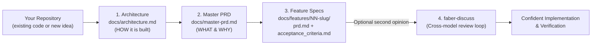
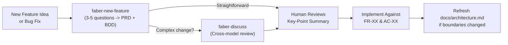

# FaberSEP Spec (`@fabersep/spec`)

[](LICENSE)

**Spec-driven engineering templates, governance rules, and `faber-*` agent skills — installed across all your AI coding tools with one command.**

Zero runtime dependencies. Zero template files dumped into your repositories. Zero idle token overhead. Run `npx @fabersep/spec init`, pick your AI coding tools from an interactive checklist, and start turning any codebase or raw idea into verified Architecture docs, Master PRDs, and atomic Given-When-Then BDD specs.

---

## Table of Contents

- [Why FaberSEP Spec?](#why-fabersep-spec)
- [How It Works (The 2-Minute Mental Model)](#how-it-works-the-2-minute-mental-model)
- [Prerequisites](#prerequisites)
- [Step-by-Step Quickstart](#step-by-step-quickstart)
- [Everyday Development Cycle](#everyday-development-cycle)
- [Included Skills](#included-skills)
- [Supported AI Coding Tools](#supported-ai-coding-tools)
- [Updating & Uninstalling](#updating--uninstalling)
- [CLI Command Reference](#cli-command-reference)
- [Running from Source (Contributors)](#running-from-source-contributors)
- [Works Great With](#works-great-with)
- [Documentation & Specs](#documentation--specs)
- [License](#license)

---

## Why FaberSEP Spec?

*"Can't I just ask my AI coding agent to write a spec or paste a Markdown template into my repo?"*

Ad-hoc prompting produces inconsistent docs that drift from the codebase and hallucinate APIs. Copy-pasting template folders into every repository pollutes your git history and goes stale fast. **`@fabersep/spec` solves all of these at once:**

| | Ad-Hoc Prompting | Copy-Paste Templates in Repo | `@fabersep/spec` |
| :--- | :--- | :--- | :--- |
| **Setup** | Re-explain rules every chat | Copy & sync files in every repo | **One command (`npx @fabersep/spec init`) for all tools** |
| **Repo Cleanliness** | Unstructured notes | Template & prompt clutter in git | **Zero boilerplate in your repo — only clean `docs/`** |
| **Accuracy** | Hallucinates APIs & flags | No verification rules | **Evidence-first; unknowns marked `GAP-XX`** |
| **Idle Token Cost** | Long system prompts | Always-on instruction bloat | **Zero idle tokens; skills load only when invoked** |
| **Multi-Tool Support** | Tied to one chat | Manual per-tool setup | **Antigravity, Claude Code/Desktop, Codex, Cursor** |

---

## How It Works (The 2-Minute Mental Model)



If you are new to spec-driven development with AI coding agents, here is the whole idea in 4 points:

1. **Three separate kinds of truth (never mixed together):**
   - **Architecture (`docs/architecture.md`) — *HOW the system is built*:** Real folders, modules, data flows, and entry points verified directly from your code.
   - **Product Requirements (`docs/master-prd.md` and `docs/features/<NN>-<slug>/prd.md`) — *WHAT & WHY*:** Users, workflows, functional requirements (`FR-XX`), and explicit non-goals (`NG-XX`) in plain product language.
   - **Acceptance Criteria (`docs/features/<NN>-<slug>/acceptance_criteria.md`) — *HOW we verify it*:** Atomic `GIVEN / WHEN / THEN` BDD scenarios (`AC-XX`) mapped 1-to-1 to `FR-XX`, with zero internal code identifiers.
2. **Evidence first, zero hallucination:** When documenting an existing repo, skills verify real files before writing and record missing information openly as `GAP-XX` instead of guessing.
3. **Installed globally once, clean in every repo:** `npx @fabersep/spec init` installs one canonical copy under `~/.faber/spec/` and links it into your AI coding tools. Your project repositories stay clean — only the generated `docs/` files are written.
4. **Optional cross-model review (`faber-discuss`):** Before coding a tricky feature, your active agent can debate the design and spec with a second read-only model (`claude` or `agy` CLI) and hand you a short key-point summary + owner questions.

---

## Prerequisites

- **Node.js 20 or newer** (`node -v` to check) — needed for `npx @fabersep/spec init`
- **One or more supported AI coding tools:** Antigravity, Claude Code / Claude Desktop, OpenAI Codex, or Cursor
- *(Optional)* **Python 3** + `agy` or `claude` CLI — only needed if you use `faber-discuss`

You do **not** need to clone this repository or install anything globally to get started.

---

## Step-by-Step Quickstart

Follow these 4 steps. Setup takes under 30 seconds and is completely reversible.

### Step 1: Install into your AI coding tools

Run:

```bash
npx @fabersep/spec init
```

The installer automatically scans your machine for installed AI coding tools (`~/.gemini`, `~/.claude`, `~/.codex`, `~/.cursor`) and opens an interactive checklist with detected tools pre-selected:

```text
FaberSEP Spec v0.2.0 — Select AI coding tools to install into:
Detected tools are pre-selected. Uncheck any tool to skip or remove it, then press Enter.

  > [x] Antigravity             (detected: ~/.gemini)
    [x] Claude Code / Desktop   (detected: ~/.claude)

  2 selected  •  ↑/↓ move  •  Space toggle  •  a toggle all  •  Enter install  •  q cancel
```

- Use **↑ / ↓** to move, **Space** to check or uncheck any tool, and **Enter** to install.
- Prefer a non-interactive one-liner?
  ```bash
  # Install into all auto-detected tools without prompting
  npx @fabersep/spec init --yes

  # Or target specific tools explicitly
  npx @fabersep/spec init --engine antigravity,claude-code,codex,cursor

  # Preview what would change without touching disk
  npx @fabersep/spec init --yes --dry-run
  ```

**What this does:**
- Stages one clean copy of the rules, templates, manifests, and 5 `faber-*` skills in `~/.faber/spec/`.
- Wires each selected tool automatically (native plugin link for Antigravity and Claude Code/Desktop; per-skill links for Codex and Cursor).
- Never overwrites unmanaged folders — if a non-FaberSEP directory exists at a target path, it backs it up to `.bak.<timestamp>` first.

Verify your installation anytime:

```bash
npx @fabersep/spec status
```

### Step 2: Document an existing project (Brownfield)

Open any repository in your AI coding tool (start a new session so it loads the newly installed skills) and run these three prompts in order:

1. **Map the codebase reality:**
   > *"Run `faber-init-arch` to document this repository's architecture."*
   - Creates `docs/architecture.md` grounded in real source files.
2. **Capture product intent:**
   > *"Run `faber-init-prd` to generate the Master PRD."*
   - Creates `docs/master-prd.md` with vision, personas, journeys, non-goals, and gaps.
3. **Extract existing features into PRDs + BDDs:**
   > *"Run `faber-extract-features` to extract existing feature PRDs and BDDs."*
   - Creates `docs/features/README.md` and `docs/features/<NN>-<slug>/{prd.md, acceptance_criteria.md}` for each capability.

### Step 3: Specify a new feature before coding (Greenfield)

Whenever you want to build something new, ask your agent:

> *"Run `faber-new-feature` for `<your feature idea>`."*

The agent reads your existing `docs/master-prd.md` and `docs/architecture.md`, asks **3–5 short clarifying questions** (caller, edge cases, state, compatibility, non-goals), and writes a traceable `prd.md` + `acceptance_criteria.md` for your approval before writing a single line of code.

### Step 4: (Optional) Stress-test a design with a second model

For non-trivial features or architectural changes, ask your agent:

> *"Run `faber-discuss` to review this design and spec with a second model."*

Your active agent (`author`) briefs a read-only external reviewer (`claude` or `agy` CLI), works through numbered findings (`F-1`, `F-2`, ...), enforces token budgets, saves a full audit ledger, and hands you a concise summary + numbered owner questions (`OQ-1`, ...).

---

## Everyday Development Cycle



---

## Included Skills

All skills in `@fabersep/spec` use the `faber-` prefix to prevent naming collisions with other plugins.

| Skill | When to Use It | Output |
| :--- | :--- | :--- |
| `faber-init-arch` | Documenting an existing codebase or drafting architecture for a new project | `docs/architecture.md` |
| `faber-init-prd` | Synthesizing product vision, personas, journeys, non-goals, and KPIs | `docs/master-prd.md` |
| `faber-extract-features` | Bringing an existing repo up to spec-driven standards | `docs/features/README.md` + per-feature `prd.md` & `acceptance_criteria.md` |
| `faber-new-feature` | Clarifying and specifying a new feature before writing code | `docs/features/<NN>-<slug>/{prd.md, acceptance_criteria.md}` |
| `faber-discuss` | Running a read-only cross-model design & spec review (`agy` or `claude` CLI) | Review ledger (`decisions.md`, `stats.md`, `summary.md`) + reviewed PRD/BDD |

---

## Supported AI Coding Tools

| Tool | Detection Path | Installed Location | Layout |
| :--- | :--- | :--- | :--- |
| **Antigravity** | `~/.gemini` | `~/.gemini/config/plugins/faber-spec` | Full native plugin (`plugin.json` + all skills) |
| **Claude Code / Desktop** | `~/.claude` | `~/.claude/skills/faber-spec` | Full Claude plugin (`.claude-plugin/plugin.json` + all skills) |
| **OpenAI Codex** | `~/.codex` | `~/.codex/skills/faber-*` | Per-skill links pointing to `~/.faber/spec/skills/` |
| **Cursor** | `~/.cursor` | `~/.cursor/skills/faber-*` | Per-skill links pointing to `~/.faber/spec/skills/` |

*(All 5 skills resolve `rules/` and `templates/` both from relative plugin paths and from `~/.faber/spec/`, so every tool works identically.)*

---

## Updating & Uninstalling

### Update to the latest version

Re-run `init` with `@latest` — it safely refreshes `~/.faber/spec/` and keeps your tool links intact:

```bash
npx @fabersep/spec@latest init --yes
```

### Uninstall cleanly

Remove all tool links and `~/.faber/spec/` (never touches `docs/` inside your project repos):

```bash
npx @fabersep/spec uninstall
```

Or remove from a single tool only:

```bash
npx @fabersep/spec uninstall --engine cursor
```

---

## CLI Command Reference

| Command | Description |
| :--- | :--- |
| `npx @fabersep/spec init` | Auto-detect AI tools and open the interactive checkbox installer. |
| `npx @fabersep/spec init --yes` | Install into all auto-detected tools without prompting. |
| `npx @fabersep/spec init --engine <list>` | Install into specific tools (`antigravity`, `claude-code`, `codex`, `cursor`). |
| `npx @fabersep/spec init --dry-run` | Preview planned changes without modifying disk. |
| `npx @fabersep/spec init --link` | Link tools directly to a local Git checkout (for contributors). |
| `npx @fabersep/spec status` | Show installed version, skills, and connected AI coding tools. |
| `npx @fabersep/spec uninstall [--engine <list>]` | Remove managed links and `~/.faber/spec/` cleanly. |

---

## Running from Source (Contributors)

If you want to hack on templates, rules, or skills locally and see changes immediately in your AI tools:

```bash
git clone https://github.com/fabersep/spec.git
cd spec
npm test
node src/cli.mjs init --link
```

`--link` points your selected AI tools directly at your local checkout instead of copying to `~/.faber/spec/`.

---

## Works Great With

`@fabersep/spec` works completely standalone in any repository. If you want optional companion tools from the same open-source suite:

- **[FaberSEP Memory (`@fabersep/memory`)](https://github.com/fabersep/memory):** Prefix-cache-first, Git-backed Markdown memory across all your AI coding tools.
- **[FaberSEP Atlas (`@fabersep/atlas`)](https://github.com/fabersep/atlas):** Deterministic AST code map & MCP server. When Atlas MCP is connected, `faber-init-arch`, `faber-init-prd`, and `faber-extract-features` automatically use it to map codebases with far fewer tokens.
- **[FaberSEP Blueprints](https://fabersep.dev):** Build-verified project scaffolds and recipes.

---

## Documentation & Specs

This repository dogfoods its own FaberSEP Spec standard:

- [Master PRD](docs/master-prd.md)
- [Architecture Guide](docs/architecture.md)
- [Features Index](docs/features/README.md)
  - [01 — Core Spec Plugin](docs/features/01-antigravity-spec-plugin/prd.md)
  - [02 — Multi-Agent CLI Installer & Cross-Model Discuss](docs/features/02-cli-installer-and-cross-model-discuss/prd.md)

---

## License

Apache-2.0 — see [LICENSE](LICENSE).
