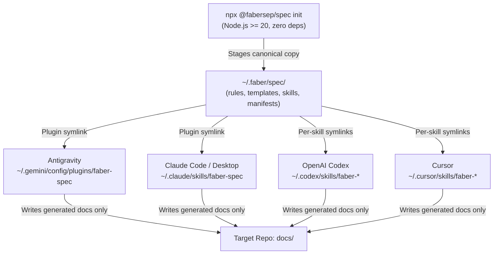
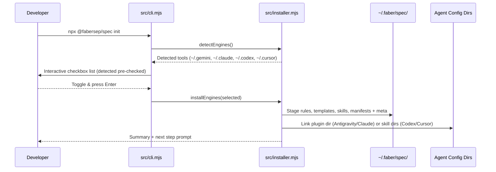
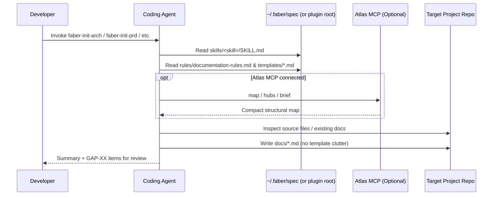

# FaberSEP Spec — Architecture Guide

> **Purpose:** Documents the verified technical architecture of `fabersep/spec` (`@fabersep/spec`) — zero-dependency CLI installer, canonical `~/.faber/spec/` store, multi-agent plugin/skill layout, `faber-discuss` runner, and architectural invariants. Grounded strictly in repository reality.

---

## 1. System Overview & Runtime Topology

FaberSEP Spec (`v0.2.0`) combines:
1. **A pure-Markdown spec kit** (`rules/`, `templates/`, `skills/faber-*/`) plus native plugin manifests (`plugin.json` for Antigravity, `.claude-plugin/plugin.json` for Claude Code / Desktop).
2. **A zero-dependency Node.js (>=20) CLI installer** (`src/cli.mjs`, `src/installer.mjs`, `src/prompt.mjs`) distributed as `@fabersep/spec` on npm. It stages a single canonical copy under `~/.faber/spec/` and links it into whichever AI coding tools the user selects (Antigravity, Claude Code / Desktop, OpenAI Codex, Cursor).
3. **A Python 3 read-only reviewer runner** (`skills/faber-discuss/discuss_round.py`, `discuss_log.py`) used only when the user explicitly invokes `faber-discuss`.

No background daemon, database, build step, or runtime npm dependencies are required.

---

## 2. Module Boundaries

| Module / Directory | Responsibility | Allowed Dependencies | Notes |
| :--- | :--- | :--- | :--- |
| `src/` | Interactive CLI installer, engine detection, staging, status, uninstall | Node.js built-ins only (`fs`, `os`, `path`, `readline`, `url`) | Zero runtime dependencies, zero build step |
| `plugin.json`, `.claude-plugin/plugin.json` | Native plugin manifests for Antigravity and Claude Code/Desktop | None | Versions stay synchronized with `package.json` |
| `rules/` | Universal documentation invariants loaded on demand | None | Never injected globally on idle turns |
| `templates/` | Canonical Markdown skeletons for generated project docs | None | Project-type agnostic; zero stack-specific hardcoding |
| `skills/faber-*/` | Procedural instructions for each workflow command | `rules/`, `templates/`, optional Atlas MCP; `faber-discuss` uses Python 3 stdlib + `agy`/`claude` CLI | All skills prefixed with `faber-`; dual path lookup (`../../` and `~/.faber/spec/`) |
| `tests/` | Automated Node + Python test suites | `node:test`, Python `unittest` | Zero external test framework dependencies |
| `docs/` | Living specs for `fabersep/spec` itself | Follows `templates/` and `rules/` | Dogfooding reference |

---

## 3. Core Data & Execution Flows

### Flow 1: One-Command Install (`npx @fabersep/spec init`)

### Flow 2: Running a `faber-*` Skill in Any Target Project

---

## 4. Public Interfaces & Contracts

- **CLI (`faber-spec` / `npx @fabersep/spec`):**
  - `init [--yes|-y] [--engine <list>] [--dry-run] [--link] [--undo]` — Interactive or non-interactive multi-agent setup
  - `status` — Prints `~/.faber/spec/` version, skills, and per-engine link status
  - `uninstall [--engine <list>] [--dry-run]` — Cleanly removes managed links and `~/.faber/spec/`
  - `--help`, `--version`
- **Plugin Manifests:**
  - `plugin.json` (Antigravity) and `.claude-plugin/plugin.json` (Claude Code / Desktop), synchronized to `0.2.0`
- **Agent Skills (`skills/faber-*/SKILL.md`):**
  - `faber-init-arch` -> writes `docs/architecture.md`
  - `faber-init-prd` -> writes `docs/master-prd.md`
  - `faber-extract-features` -> writes `docs/features/README.md` and `docs/features/<NN>-<slug>/{prd.md,acceptance_criteria.md}`
  - `faber-new-feature` -> clarifies scope, then writes `docs/features/<NN>-<slug>/{prd.md,acceptance_criteria.md}` and updates `docs/features/README.md`
  - `faber-discuss` -> runs a read-only cross-model design/spec review loop via `discuss_round.py` and logs structured stats via `discuss_log.py`
- **Generated Document Frontmatter Contract:** Every generated document starts with YAML frontmatter containing `id`, `type`, `status`, and `last_updated`.

---

## 5. Cross-Cutting Concerns

| Concern | Status | Implementation / Approach | Location |
| :--- | :--- | :--- | :--- |
| **Error Handling** | `Implemented` | Explicit CLI exit codes, unknown-engine validation, Windows symlink-to-copy fallback, non-destructive `.bak` backup for unmanaged directories; structured exit codes (`0,2,3,4,5`) in `discuss_round.py` | `src/cli.mjs`, `src/installer.mjs`, `skills/faber-discuss/discuss_round.py` |
| **Configuration & Defaults** | `Implemented` | Zero-config engine auto-detection (`~/.gemini`, `~/.claude`, `~/.codex`, `~/.cursor`) + `FABER_USER_HOME` override for isolated tests | `src/installer.mjs` |
| **Caching & Incrementality** | `Implemented` | On-demand skill loading (zero always-on rule injection); 7-minute warm prompt-cache tracking in `faber-discuss` | `skills/`, `skills/faber-discuss/discuss_round.py` |
| **Security & Privacy** | `Implemented` | 100% local execution, zero telemetry, zero external npm dependencies; strict read-only tool allow/deny lists for `faber-discuss` reviewers | Entire repo, `skills/faber-discuss/discuss_round.py` |
| **Logging & Diagnostics** | `Implemented` | Structured per-run JSONL ledger (`run.json`, `rounds.jsonl`, `rulings.jsonl`, `stats.md`) for `faber-discuss`; `faber-spec status` for install diagnostics | `skills/faber-discuss/discuss_log.py`, `src/cli.mjs` |
| **Testing & Quality Gates** | `Implemented` | Built-in Node.js test suite (`tests/test_installer.test.mjs`) + Python unittest suite (`tests/test_faber_discuss.py`) run via `npm test` | `tests/` |

---

## 6. Architectural Invariants & Anti-Patterns

### Invariants (Must Hold)
- **Zero target-repo pollution:** Skills write only generated project docs under `docs/`; they never copy templates, rules, or plugin manifests into the user's repository.
- **Zero idle token tax:** Do not add an always-on global rules file; rules load only when a `faber-*` skill runs.
- **Zero runtime npm dependencies:** `src/` uses only Node.js >=20 standard library modules so `npx @fabersep/spec init` stays fast and auditable.
- **Collision-safe naming:** Every skill name must start with `faber-`.
- **Single source of truth:** All four supported agent environments point to the same canonical `~/.faber/spec/` (or local checkout with `--link`) without duplicating content across `rules/` and `templates/`.

### Prohibited Practices
- ❌ **Hardcoding stack or domain assumptions in core templates:** Never require mobile monetization, specific cloud vendors, or UI screens in base templates.
- ❌ **Embedding internal agent-engine macros:** Never use non-standard engine directives that external coding agents cannot execute.
- ❌ **Overwriting unmanaged user directories silently:** Always back up any non-managed directory before linking.

---

## 7. Technical Debt & Open Architectural Questions

- **GAP-01:** Automated GitHub Actions CI workflow and thin MCP server (`@fabersep/spec mcp`) for deterministic external spec linting are deferred to a later release (`v0.3`).
- **GAP-02 (Resolved in v0.2.0):** Multi-agent support (Claude Code / Desktop `.claude-plugin/plugin.json`, OpenAI Codex, and Cursor) is now implemented via the interactive `npx @fabersep/spec init` installer.
