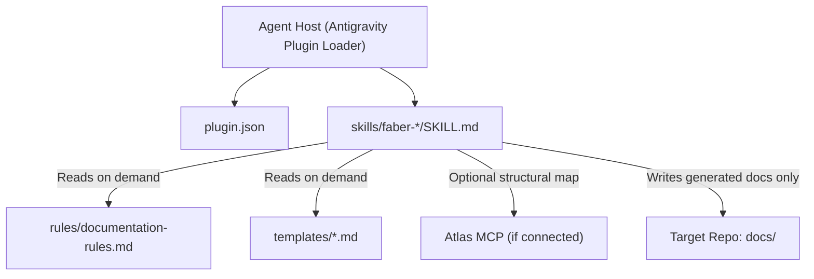
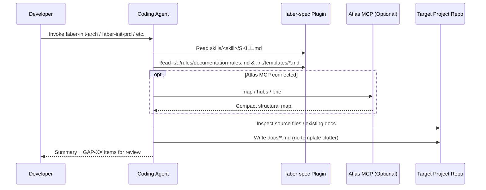

# FaberSEP Spec — Architecture Guide

> **Purpose:** Documents the verified technical architecture of `fabersep/spec` — plugin layout, skill-to-template loading flow, interfaces, and architectural invariants. Grounded strictly in repository reality.

---

## 1. System Overview & Runtime Topology

FaberSEP Spec (`v0.1.0`) is a zero-runtime, pure-Markdown agent plugin repository. It requires no background daemon, build step, or external network access.

Antigravity discovers the plugin directly from the repository root (`plugin.json` + `skills/`). Each skill loads its companion rules and templates on demand from relative paths inside the plugin directory, keeping idle token overhead at zero and adding no template files to the target user's repository.



---

## 2. Repository Structure & Module Boundaries

```text
spec/
├── plugin.json                         # Antigravity plugin manifest (global name: faber-spec)
├── README.md                           # User-facing overview and install instructions
├── LICENSE                             # Apache-2.0 license
├── rules/
│   └── documentation-rules.md          # Core spec-driven governance & invariants
├── templates/
│   ├── architecture.md                 # Project-agnostic architecture template
│   ├── master-prd.md                   # Project-agnostic Master PRD template
│   ├── feature-prd.md                  # Feature PRD template (FR-XX)
│   └── feature-bdd.md                  # Given-When-Then BDD template (AC-XX)
├── skills/
│   ├── faber-init-arch/SKILL.md        # Architecture synthesis (brownfield & greenfield)
│   ├── faber-init-prd/SKILL.md         # Master PRD synthesis
│   ├── faber-extract-features/SKILL.md # Brownfield feature PRD + BDD extraction
│   └── faber-new-feature/SKILL.md      # Greenfield feature clarification + PRD/BDD generation
└── docs/                               # FaberSEP Spec's own dogfooded specs
    ├── architecture.md
    ├── master-prd.md
    └── features/
```

| Module / Directory | Responsibility | Allowed Dependencies | Notes |
| :--- | :--- | :--- | :--- |
| `plugin.json` | Declares plugin identity, metadata, and starter prompts for Antigravity | None | Uses only loader-supported top-level fields |
| `rules/` | Holds universal documentation invariants loaded on demand | None | Intentionally not `rules/AGENTS.md` to avoid per-turn prompt bloat |
| `templates/` | Canonical Markdown skeletons for generated project docs | None | Project-type agnostic; zero stack-specific hardcoding |
| `skills/faber-*/` | Procedural instructions for each workflow command | `rules/`, `templates/`, optional Atlas MCP | All skills prefixed with `faber-` to prevent collisions |
| `docs/` | Living specs for `fabersep/spec` itself | Follows `templates/` and `rules/` | Dogfooding reference |

---

## 3. Core Data & Execution Flows

### Flow 1: Running a `faber-*` Skill in Any Target Project


---

## 4. Public Interfaces & Contracts

- **Plugin Manifest (`plugin.json`):** Antigravity JSONC manifest (`name: "faber-spec"`, `version: "0.1.0"`).
- **Agent Skills (`skills/faber-*/SKILL.md`):**
  - `faber-init-arch` -> writes `docs/architecture.md`
  - `faber-init-prd` -> writes `docs/master-prd.md`
  - `faber-extract-features` -> writes `docs/features/README.md` and `docs/features/<NN>-<slug>/{prd.md,acceptance_criteria.md}`
  - `faber-new-feature` -> clarifies scope, then writes `docs/features/<NN>-<slug>/{prd.md,acceptance_criteria.md}` and updates `docs/features/README.md`
- **Generated Document Frontmatter Contract:** Every generated document starts with YAML frontmatter containing `id`, `type`, `status`, and `last_updated`.

---

## 5. Cross-Cutting Concerns

| Concern | Status | Implementation / Approach | Location |
| :--- | :--- | :--- | :--- |
| **Error Handling** | `N/A` | Pure Markdown plugin; no executable runtime code in `v0.1.0` | — |
| **Configuration & Defaults** | `Implemented` | Zero-config plugin discovery via `plugin.json` | `plugin.json` |
| **Caching & Incrementality** | `Implemented` | On-demand skill loading; zero always-on rule injection | `skills/`, `rules/` |
| **Security & Privacy** | `Implemented` | Local-only static Markdown; zero network calls, zero telemetry | Entire repo |
| **Logging & Diagnostics** | `N/A` | No runtime process in `v0.1.0` | — |
| **Testing & Quality Gates** | `Partial` | Manual dogfooding on `spec` and `atlas`; automated spec linter planned for `v0.2` | `GAP-01` |

---

## 6. Architectural Invariants & Anti-Patterns

### Invariants (Must Hold)
- **Zero target-repo pollution:** Skills write only generated project docs under `docs/`; they never copy templates, rules, or plugin manifests into the user's repository.
- **Zero idle token tax:** Do not add a global always-on `rules/AGENTS.md` unless explicitly needed; rules load only when a `faber-*` skill runs.
- **Collision-safe naming:** Every skill name must start with `faber-`.
- **Single source of truth:** Future layers (Claude Code plugin manifest, thin MCP server) must serve the exact same `rules/` and `templates/` files without duplicating content.

### Prohibited Practices
- ❌ **Hardcoding stack or domain assumptions in core templates:** Never require mobile monetization, specific cloud vendors, or UI screens in base templates.
- ❌ **Embedding internal agent-engine macros:** Never use non-standard engine directives (such as `@TopologyFULL`) that external coding agents cannot execute.

---

## 7. Technical Debt & Open Architectural Questions

- **GAP-01:** Automated validation script / CI check (frontmatter check, placeholder check, `plugin.json` schema check) is not yet implemented; planned alongside the thin MCP layer (`v0.2`).
- **GAP-02:** Claude Code plugin manifest (`.claude-plugin/`) is deferred to the next iteration after Antigravity dogfooding on Atlas.
