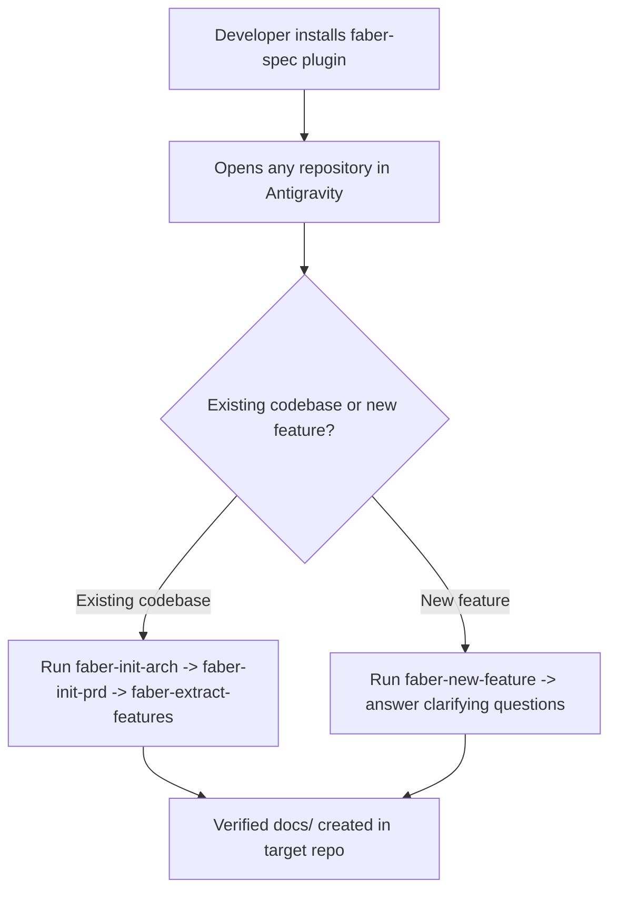

# Antigravity Spec Plugin — Product Requirements Document (PRD)

> **Purpose:** Defines the `faber-spec` Antigravity plugin bundle (first shipped in `v0.1.0`): project-agnostic documentation templates, governance rules, and the four core `faber-*` workflow skills. The installer, other tools and `faber-discuss` are feature 02. Verification scenarios live in `acceptance_criteria.md`.

---

## 1. Capability Scope Matrix

| Capability | Target Release | Priority | Primary User / Caller | Status |
| :--- | :--- | :--- | :--- | :--- |
| **Antigravity Plugin Manifest (`faber-spec`)** | `v0.1.0` | `P0 (Must Have)` | Developer using Antigravity | `Implemented` |
| **Project-Agnostic Core Templates & Rules** | `v0.1.0` | `P0 (Must Have)` | Coding Agent / Developer | `Implemented` |
| **Brownfield Docs Skills (`faber-init-arch`, `faber-init-prd`, `faber-extract-features`)** | `v0.1.0` | `P0 (Must Have)` | Maintainer of existing repo | `Implemented` |
| **Greenfield Feature Skill (`faber-new-feature`)** | `v0.1.0` | `P0 (Must Have)` | Developer adding a feature | `Implemented` |

---

## 2. Problem Statement & Value

### 2.1 Problem
Developers using Antigravity need a repeatable way to produce Master PRDs, architecture guides, and BDD feature specs without copying template directories into every repository or manually prompting the agent with long instructions.

### 2.2 Expected Outcome
Installing `faber-spec` once makes four `faber-*` skills available across every repository, producing consistent, evidence-grounded `docs/` with zero template clutter in target repos and zero idle token overhead.

---

## 3. Explicit Non-Goals

- **NG-01:** Claude Code plugin manifest and MCP server packaging (tracked as subsequent features).
- **NG-02:** Automated spec linter CLI (deferred to `v0.2`).

---

## 4. Functional Requirements

### FR-01: Valid Antigravity Plugin Bundle
- The repository root must act directly as a valid Antigravity plugin with `plugin.json` using only supported top-level fields (`name: "faber-spec"`, `displayName`, `description`, `version`, `author`, `homepage`, `repository`, `suggestedPrompts`).
- All bundled skills must be prefixed with `faber-` to prevent name collisions.

### FR-02: Zero Idle Token Overhead & Zero Target-Repo Pollution
- Core documentation rules and templates must be loaded on demand when a `faber-*` skill runs, not injected into every unrelated turn.
- Running any `faber-*` skill must write only generated documentation under the target repository's `docs/` directory and never copy template or plugin files into the target repository.

### FR-03: Brownfield Architecture & Master PRD Synthesis
- `faber-init-arch` must inspect the codebase (using Atlas MCP automatically when available, or direct file inspection otherwise) and write `docs/architecture.md` grounded in verified code reality.
- `faber-init-prd` must synthesize `docs/master-prd.md` aligned with codebase reality and architecture, recording unknowns as `GAP-XX` rather than guessing.

### FR-04: Feature Extraction & New Feature Specification
- `faber-extract-features` must identify cohesive features in an existing codebase and generate `docs/features/README.md` plus `prd.md` and `acceptance_criteria.md` per feature.
- `faber-new-feature` must evaluate missing product dimensions, ask 3–5 focused questions when scope is unclear, and generate `prd.md` and atomic `GIVEN / WHEN / THEN` `acceptance_criteria.md` with `FR-XX` to `AC-XX` traceability and zero internal code identifiers.

---

## 5. Primary User / Execution Flow

---

## 6. Edge Cases & Failure Modes

| Condition | Expected System Response |
| :--- | :--- |
| **Atlas MCP not installed** | Skills fall back cleanly to direct repository inspection without error. |
| **Target repo already has `docs/architecture.md` or `docs/features/`** | Skills update affected sections surgically and skip duplicating existing feature folders. |
| **Empty / greenfield repository** | `faber-init-arch` and `faber-init-prd` ask 3–5 focused setup questions before drafting instead of hallucinating a codebase. |

---

## 7. Open Questions & Dependencies

| ID | Question / Dependency | Impact | Status |
| :--- | :--- | :--- | :--- |
| **OQ-01** | Whether to add a square SVG logo for Antigravity UI cards | Visual polish | `Open` |
