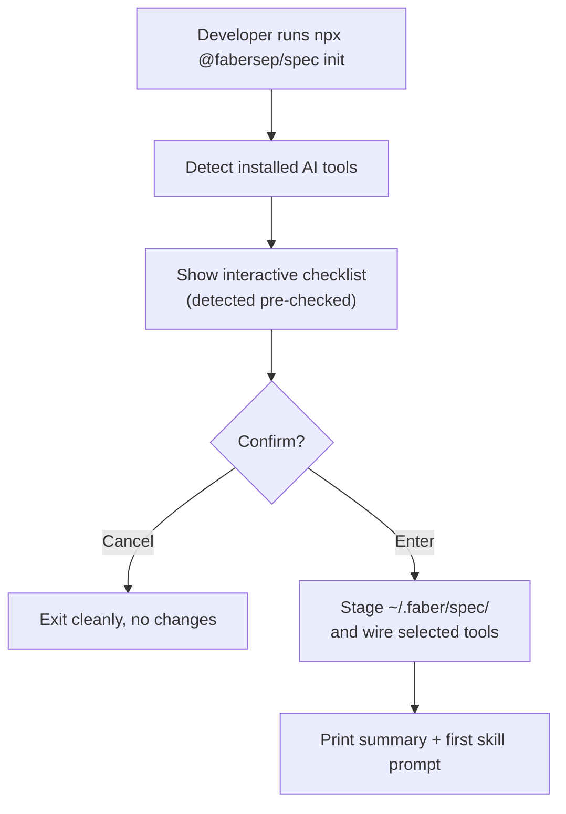

# Multi-Agent CLI Installer & Cross-Model Discuss — Product Requirements Document (PRD)

> **Purpose:** Defines the `v0.2.x` capabilities of `@fabersep/spec`: a one-command interactive CLI installer supporting Antigravity, Claude Code / Desktop, OpenAI Codex, and Cursor, plus the model-agnostic `faber-discuss` review skill. Verification scenarios live in `acceptance_criteria.md`.

---

## 1. Capability Scope Matrix

| Capability | Target Release | Priority | Primary User / Caller | Status |
| :--- | :--- | :--- | :--- | :--- |
| **Interactive Multi-Agent Installer (`npx @fabersep/spec init`)** | `v0.2.0` | `P0 (Must Have)` | Developer setting up AI coding tools | `Implemented` |
| **Status & Clean Uninstall (`status`, `uninstall`)** | `v0.2.0` | `P0 (Must Have)` | Developer inspecting or removing setup | `Implemented` |
| **Claude Code / Desktop Plugin Support** | `v0.2.0` | `P0 (Must Have)` | Developer using Claude Code or Desktop | `Implemented` |
| **Cross-Model Design & Spec Review (`faber-discuss`)** | `v0.2.0` | `P0 (Must Have)` | Developer wanting a second-model review | `Implemented` |

---

## 2. Problem Statement & Value

### 2.1 Problem
Manual `git clone` and symlink instructions create friction for new users and only covered Antigravity in `v0.1.0`. Additionally, teams using multiple AI coding tools (Claude Code, Antigravity, Codex, Cursor) need one consistent installation path and a model-agnostic way to run cross-model design and spec reviews before coding.

### 2.2 Expected Outcome
A developer runs a single command (`npx @fabersep/spec init`), sees their installed AI coding tools pre-selected in a checklist, presses Enter, and immediately gets all five `faber-*` skills wired into every selected tool — with zero manual symlinks and zero clutter inside their project repositories.

---

## 3. Explicit Non-Goals

- **NG-01:** Running an MCP server or automated spec linter CLI (deferred to `v0.3`).
- **NG-02:** Editing user repository files during `init` or `uninstall`.
- **NG-03:** Allowing the `faber-discuss` reviewer to edit files or execute shell commands.

---

## 4. Functional Requirements

### FR-01: Auto-Detection & Interactive Tool Selection
- Running `npx @fabersep/spec init` must detect which supported AI coding tools are present on the user's machine (Antigravity, Claude Code / Desktop, OpenAI Codex, Cursor).
- In an interactive terminal, the installer must show a checkbox list with detected tools pre-checked so the user can toggle any tool on or off before installing.
- Running `init` applies the installation directly (no separate confirm or setup step); unmanaged paths are backed up and `init --undo` reverses it.
- Non-interactive flags (`--yes`, `--engine <list>`, `--preview` / `--dry-run`) must allow scripted or preview-only runs without prompting. `--apply` is accepted as a backwards-compatible alias of the default behavior.
- An empty tool list (for example `--engine=`) must be rejected with the list of supported tools instead of reporting a successful install.

### FR-02: Single Canonical Store & Safe Multi-Agent Wiring
- The installer must stage one canonical copy of the rules, templates, manifests, and `faber-*` skills under `~/.faber/spec/` with version metadata.
- Antigravity and Claude Code / Desktop must be wired as full plugin directories; OpenAI Codex and Cursor must have each `faber-*` skill linked cleanly into their global skills directories.
- If a target directory already exists and is not managed by FaberSEP Spec, the installer must back it up rather than overwriting it silently.
- All five `faber-*` skills must resolve rules and templates cleanly both in plugin layout and in standalone per-skill layout.
- When a newer version no longer ships a skill, re-running `init` must remove that skill's managed link from per-skill tools (Codex, Cursor), so no broken links stay behind.
- The plugin manifests must pass each tool's own plugin validator (for Antigravity: every rule declares a trigger, at most three suggested prompts).

### FR-03: Status Diagnostics & Clean Uninstall
- `npx @fabersep/spec status` must report the installed canonical version, skill list, and per-tool detection and installation state. A folder or link at a target path that FaberSEP Spec does not own is reported as not managed, never as installed. A contributor install made with `--link` is reported as linked to its checkout.
- A path counts as owned by FaberSEP Spec only when it (or, for a link, the folder it points to) carries the FaberSEP Spec install marker, the `faber-spec` plugin manifest, or a `faber-*` skill; any other folder or link is left untouched by `init` (backed up) and `uninstall` (skipped).
- `npx @fabersep/spec uninstall` (and `init --undo`) must remove managed links/files and the canonical store without touching any project repository's `docs/` folder.

### FR-04: Model-Agnostic Cross-Model Review (`faber-discuss`)
- `faber-discuss` must support both `agy` and `claude` CLIs as read-only reviewers, enforcing strict read-only permissions (no file writes, no shell execution).
- Every round must record normalized token usage, verdict, and findings in a structured run ledger and support a `--test` guard restricted to the cheapest test models.

---

## 5. Primary User / Execution Flow

---

## 6. Edge Cases & Failure Modes

| Condition | Expected System Response |
| :--- | :--- |
| **No supported AI tools detected in `--yes` mode** | Prints a clear message with `--engine` usage and exits with non-zero status without modifying disk. |
| **Unknown `--engine` name** | Rejects immediately with the list of supported engines. |
| **User cancels interactive prompt (`q`, `Esc`, `Ctrl+C`)** | Restores terminal mode cleanly and makes zero filesystem changes. |
| **Platform denies symlink creation (e.g. Windows without developer mode)** | Falls back cleanly to copying the files and reports `copy` mode. |
| **Unmanaged directory exists at a target path** | Moves the existing directory to a timestamped `.bak` backup before linking. |
| **A user's own link sits at a skill or plugin path** | `uninstall` leaves it in place; `status` reports it as not managed. |
| **Empty tool list (`--engine=`)** | Rejects with the list of supported tools and exits non-zero without modifying disk. |

---

## 7. Open Questions & Dependencies

| ID | Question / Dependency | Impact | Status |
| :--- | :--- | :--- | :--- |
| **OQ-01** | Whether to add Windsurf or Gemini CLI standalone skill targets in `v0.3` | Additional engines | `Open` |
