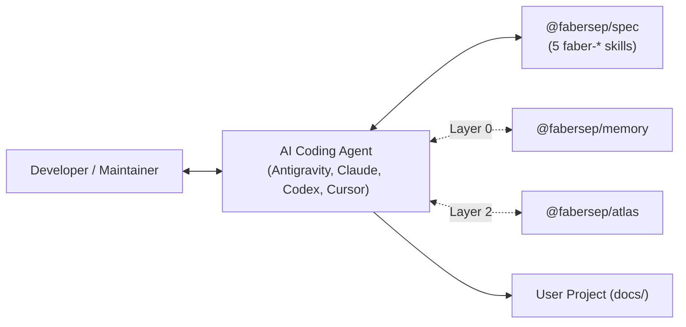

# FaberSEP Spec — Master Product Requirements Document (PRD)

> **Purpose:** Defines the vision, target users, core workflows, scope boundaries, and quality signals for **FaberSEP Spec** (`@fabersep/spec`). Low-level layout and installer mechanics live in `docs/architecture.md`.

---

## 1. Executive Summary & Vision

### 1.1 What is FaberSEP Spec?
FaberSEP Spec (`@fabersep/spec`) is **Layer 1** of the open-source (Apache-2.0) FaberSEP engineering context stack (`@fabersep/memory` -> `@fabersep/spec` -> `@fabersep/atlas` -> `@fabersep/blueprints`). It packages project-agnostic documentation templates, governance rules, and five `faber-*` AI coding agent skills into a single zero-dependency npm package with a one-command interactive installer (`npx @fabersep/spec init`).

### 1.2 Core Value Proposition
- **For Developers Using AI Coding Agents:** Install once with `npx @fabersep/spec init` across Antigravity, Claude Code / Desktop, OpenAI Codex, and Cursor, then turn any undocumented repo or raw feature idea into structured, verifiable specs in minutes.
- **For Engineering Teams & Open-Source Maintainers:** Keep product intent (PRD), codebase reality (Architecture), behavioral verification (BDD), and cross-model design review (`faber-discuss`) cleanly separated and free from AI hallucinations.
- **Key Differentiator:** One-command interactive setup (auto-detects installed AI tools with toggleable checkboxes), zero target-repo boilerplate, zero idle token overhead, and zero runtime npm dependencies.

---

## 2. Problem Statement & Value Pillars

### 2.1 The Core Problem
AI coding agents move fast, but without clear architecture docs, Master PRDs, and testable BDD acceptance criteria, they drift into inconsistent abstractions, invent nonexistent APIs, and produce untestable changes. Existing spec frameworks either require heavy web UIs/servers or force developers to manually clone repos, create symlinks, or copy dozens of template files into every repository.

### 2.2 Core Value Pillars
- **Pillar 1 (One-Command Multi-Agent Install):** `npx @fabersep/spec init` detects installed AI coding tools, pre-selects them in an interactive checklist, and wires everything cleanly from a single `~/.faber/spec/` source.
- **Pillar 2 (Evidence-First, Anti-Hallucination Discipline):** Brownfield workflows ground every claim in verified code reality and record unknowns explicitly as `GAP-XX`.
- **Pillar 3 (Universal, Composable Ecosystem):** Works cleanly on CLIs, libraries, MCP servers, APIs, web apps, and mobile apps — and composes naturally with `@fabersep/memory` (shared memory), `@fabersep/atlas` (codebase maps), and `@fabersep/blueprints` (verified scaffolds).

---

## 3. Target Audience & Ecosystem

| Persona / Role | Context / Environment | Primary Goal | Key Touchpoints |
| :--- | :--- | :--- | :--- |
| **Individual Developer** | Building or maintaining a repo with Antigravity, Claude Code, Codex, or Cursor | Install in seconds and bootstrap clean specs without manual copy-paste | `npx @fabersep/spec init`, `faber-init-arch`, `faber-init-prd`, `faber-new-feature` |
| **Brownfield Maintainer** | Bringing an existing undocumented repo up to spec-driven standards | Reverse-engineer accurate architecture, Master PRD, and feature BDDs from code | `faber-init-arch`, `faber-extract-features` |
| **Tech Lead / Reviewer** | Stress-testing a complex feature design before coding | Run a structured, read-only second-opinion review with a different model | `faber-discuss` |
| **Ecosystem Contributor** | Extending FaberSEP templates, rules, or agent adapters | Add clean, reusable templates or support new agent hosts | `templates/`, `rules/`, `skills/`, `src/` |

---

## 4. Core User Journeys

### Journey 1: One-Command Setup & First Value (Onboarding)
1. **Install:** Developer runs `npx @fabersep/spec init` in any terminal.
2. **Select Tools:** CLI auto-detects installed AI tools (`~/.gemini`, `~/.claude`, `~/.codex`, `~/.cursor`) and displays them pre-checked; developer toggles if needed and presses Enter.
3. **First Value:** Developer opens any repository in their AI tool and runs `faber-init-arch` followed by `faber-init-prd`, receiving verified `docs/architecture.md` and `docs/master-prd.md` with zero template clutter added to the repo.

### Journey 2: Specifying a New Feature (Greenfield Core Loop)
1. **Trigger:** Developer invokes `faber-new-feature` with a brief feature idea.
2. **Clarification:** Agent checks `docs/master-prd.md` and `docs/architecture.md`, then asks 3–5 focused questions on missing dimensions (caller, edge cases, state, interfaces, non-goals).
3. **Output:** Agent writes `docs/features/<NN>-<slug>/prd.md` and `acceptance_criteria.md` (with `FR-XX` to `AC-XX` traceability) and updates `docs/features/README.md` for owner review before implementation.

### Journey 3: Cross-Model Design & Spec Review (`faber-discuss`)
1. **Trigger:** Developer explicitly asks the active agent to run `faber-discuss` on a design or feature spec.
2. **Loop:** Active agent (`author`) briefs an external read-only reviewer CLI (`agy` or `claude`), rules on numbered findings (`F-n`), tracks token budgets and warm cache windows, and verifies the resulting PRD/BDD.
3. **Outcome:** Developer receives a concise key-point summary, numbered owner questions (`OQ-n`) with recommended defaults, and full stats in the run ledger.

---

## 5. Capability Overview

| Capability | Status | Feature Spec | Summary |
| :--- | :--- | :--- | :--- |
| **Core Spec Plugin (`v0.1`)** | `Implemented` | [01-antigravity-spec-plugin](features/01-antigravity-spec-plugin/prd.md) | Antigravity plugin manifest, 4 project-agnostic templates, documentation rules, and 4 `faber-*` workflow skills |
| **Multi-Agent CLI Installer & `faber-discuss` (`v0.2`)** | `Implemented` | [02-cli-installer-and-cross-model-discuss](features/02-cli-installer-and-cross-model-discuss/prd.md) | Interactive `npx @fabersep/spec init` for Antigravity, Claude Code/Desktop, Codex, and Cursor; Claude plugin manifest; model-agnostic `faber-discuss` review loop |
| **Thin Spec MCP Server (`@fabersep/spec mcp`)** | `Planned` | — | Optional MCP server and deterministic spec linter (`v0.3`) |

---

## 6. Constraints & Operating Boundaries

- **Runtime / Platform Constraints:** Node.js >=20 for the CLI installer (zero runtime dependencies); Python 3 stdlib + `agy`/`claude` CLI only when running `faber-discuss`.
- **Privacy & Security Guarantees:** 100% local execution, zero telemetry, zero external network calls by the installer.
- **Packaging / Distribution:** Open-source npm package (`@fabersep/spec`, Apache-2.0) and GitHub repository (`github.com/fabersep/spec`).

---

## 7. Explicit Non-Goals (Scope Containment)

- **NG-01 (No Heavy Web UI or Orchestration Server):** FaberSEP Spec is a lightweight plugin + CLI kit, never a standalone agency dashboard or multi-agent server.
- **NG-02 (No Code Scaffolds or Stack Recipes):** Stack-specific code generation and build-verified recipes belong in FaberSEP Blueprints, not Spec.
- **NG-03 (No Codebase AST Indexing):** Deterministic code mapping and import graphs belong in FaberSEP Atlas; Spec integrates with Atlas optionally rather than duplicating it.
- **NG-04 (No Bulk Coding Standards Dump):** Language/framework coding standards are pulled in incrementally only as real needs arise.

---

## 8. Success Metrics & Quality Signals

| Metric ID | Objective | Target / Signal | Measurement Method |
| :--- | :--- | :--- | :--- |
| **KPI-01** | Zero target-repo clutter | 0 template/plugin files written into target user repos | Dogfooding checks on `spec` and `memory` |
| **KPI-02** | Fast zero-friction onboarding | Single `npx @fabersep/spec init` command wires all detected tools | Automated installer tests (`npm test`) |
| **KPI-03** | Zero idle token overhead | 0 tokens injected when no `faber-*` skill is active | Plugin structure test (no always-on rules file) |
| **KPI-04** | Spec completeness & traceability | 100% of `FR-XX` mapped to atomic `AC-XX` with 0 unresolved placeholders | Automated doc & manifest tests |

---

## 9. Context Gaps, Assumptions & Open Questions

- **GAP-01:** Automated GitHub Actions CI workflow and thin MCP linter server are deferred to `v0.3`.
- **GAP-02:** Exact Antigravity Marketplace submission metadata (e.g., square SVG logo) is optional for npm/GitHub install and will be added if published to a catalog.
