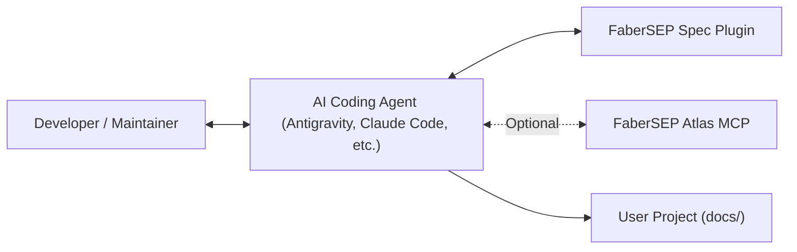

# FaberSEP Spec — Master Product Requirements Document (PRD)

> **Purpose:** Defines the vision, target users, core workflows, scope boundaries, and quality signals for **FaberSEP Spec** (`fabersep/spec`). Low-level layout and plugin mechanics live in `docs/architecture.md`.

---

## 1. Executive Summary & Vision

### 1.1 What is FaberSEP Spec?
FaberSEP Spec is an open-source (Apache-2.0) collection of project-agnostic documentation templates, governance rules, and AI coding agent skills (`faber-*`). Packaged as a lightweight plugin, it lets any developer initialize and maintain a disciplined, spec-driven documentation set (`docs/architecture.md`, `docs/master-prd.md`, and per-feature PRDs + BDD acceptance criteria) without dumping template boilerplate into their project repository.

### 1.2 Core Value Proposition
- **For Developers Using AI Coding Agents:** Turn an undocumented repo or a raw feature idea into structured, verifiable specs in minutes with one-line skill commands and zero manual file copying.
- **For Engineering Teams & Open-Source Maintainers:** Keep product intent (PRD), codebase reality (Architecture), and behavioral verification (BDD) cleanly separated and free from AI hallucinations.
- **Key Differentiator:** Installed once as a global agent plugin (zero repo clutter, zero idle token overhead), strictly project-type agnostic, and seamlessly enhanced when paired with [FaberSEP Atlas](https://github.com/fabersep/atlas) MCP.

---

## 2. Problem Statement & Value Pillars

### 2.1 The Core Problem
AI coding agents move fast, but without clear architecture docs, Master PRDs, and testable BDD acceptance criteria, they drift into inconsistent abstractions, invent nonexistent APIs, and produce untestable changes. Existing spec frameworks either require heavy web UIs/servers or force developers to copy dozens of template and prompt files into every single repository.

### 2.2 Core Value Pillars
- **Pillar 1 (Zero-Clutter Plugin Delivery):** Templates and workflow instructions live in a globally installed plugin, never polluting the user's git repository.
- **Pillar 2 (Evidence-First, Anti-Hallucination Discipline):** Brownfield workflows ground every claim in verified code reality and record unknowns explicitly as `GAP-XX`.
- **Pillar 3 (Universal, Composable Ecosystem):** Works cleanly on CLIs, libraries, MCP servers, APIs, web apps, and mobile apps — and composes naturally with Atlas (codebase maps) and Blueprints (verified code recipes).

---

## 3. Target Audience & Ecosystem

| Persona / Role | Context / Environment | Primary Goal | Key Touchpoints |
| :--- | :--- | :--- | :--- |
| **Individual Developer** | Building or maintaining a repo with Antigravity / Claude Code | Bootstrap clean specs quickly without manual copy-paste | `faber-init-arch`, `faber-init-prd`, `faber-new-feature` |
| **Brownfield Maintainer** | Bringing an existing undocumented repo up to spec-driven standards | Reverse-engineer accurate architecture, Master PRD, and feature BDDs from code | `faber-init-arch`, `faber-extract-features` |
| **Ecosystem Contributor** | Extending FaberSEP templates, rules, or agent adapters | Add clean, reusable templates or support new agent hosts | `templates/`, `rules/`, `skills/` |

---

## 4. Core User Journeys

### Journey 1: Setup & First Value (Onboarding)
1. **Install:** Developer clones or installs `fabersep/spec` into Antigravity's global plugins directory (`~/.gemini/config/plugins/faber-spec`).
2. **Discover:** Antigravity loads the plugin automatically on the next turn; no project configuration is required.
3. **First Value:** Developer opens any repository and runs `faber-init-arch` followed by `faber-init-prd`, receiving verified `docs/architecture.md` and `docs/master-prd.md` with zero template clutter added to the repo.

### Journey 2: Specifying a New Feature (Greenfield Core Loop)
1. **Trigger:** Developer invokes `faber-new-feature` with a brief feature idea.
2. **Clarification:** Agent checks `docs/master-prd.md` and `docs/architecture.md`, then asks 3–5 focused questions on missing dimensions (caller, edge cases, state, interfaces, non-goals).
3. **Output:** Agent writes `docs/features/<NN>-<slug>/prd.md` and `acceptance_criteria.md` (with `FR-XX` to `AC-XX` traceability) and updates `docs/features/README.md` for owner review before implementation.

### Journey 3: Documenting an Existing Codebase (Brownfield Adoption)
1. **Trigger:** Developer runs `faber-init-arch`, `faber-init-prd`, and `faber-extract-features` on an existing project (such as Atlas).
2. **Evidence Gathering:** Agent maps the repo (using Atlas MCP if connected, or direct file inspection) without inventing missing features.
3. **Safe Output:** Agent produces accurate `docs/` files, explicitly flagging any missing coverage or ambiguities as `GAP-XX`.

---

## 5. Capability Overview

| Capability | Status | Feature Spec | Summary |
| :--- | :--- | :--- | :--- |
| **Antigravity Spec Plugin (`v0.1`)** | `Implemented` | [01-antigravity-spec-plugin](features/01-antigravity-spec-plugin/prd.md) | Plugin manifest, 4 project-agnostic templates, documentation rules, and 4 `faber-*` skills |
| **Claude Code Plugin Adapter** | `Planned` | — | Native Claude Code plugin manifest sharing the same `skills/`, `rules/`, and `templates/` |
| **Thin Spec MCP Server (`@fabersep/spec mcp`)** | `Planned` | — | Serves templates/rules to Cursor/Windsurf/MCP clients and adds deterministic spec validation |

---

## 6. Constraints & Operating Boundaries

- **Runtime / Platform Constraints:** Pure Markdown + JSON manifest in `v0.1.0`; runs anywhere Antigravity runs with zero external dependencies.
- **Privacy & Security Guarantees:** 100% local execution, zero telemetry, zero external network calls.
- **Packaging / Distribution:** Open-source GitHub repository (`github.com/fabersep/spec`, Apache-2.0); installed globally as an Antigravity plugin.

---

## 7. Explicit Non-Goals (Scope Containment)

- **NG-01 (No Heavy Web UI or Orchestration Server):** FaberSEP Spec is a lightweight plugin/kit, never a standalone agency dashboard or multi-agent server.
- **NG-02 (No Code Scaffolds or Stack Recipes):** Stack-specific code generation and build-verified recipes belong in FaberSEP Blueprints, not Spec.
- **NG-03 (No Codebase AST Indexing):** Deterministic code mapping and import graphs belong in FaberSEP Atlas; Spec integrates with Atlas optionally rather than duplicating it.
- **NG-04 (No Bulk Coding Standards Dump in v0.1):** Language/framework coding standards are pulled in incrementally only as real needs arise.

---

## 8. Success Metrics & Quality Signals

| Metric ID | Objective | Target / Signal | Measurement Method |
| :--- | :--- | :--- | :--- |
| **KPI-01** | Zero target-repo clutter | 0 template/plugin files written into target user repos | Dogfooding checks on `spec` and `atlas` |
| **KPI-02** | Spec completeness & traceability | 100% of `FR-XX` mapped to atomic `AC-XX` with 0 unresolved placeholders | Review of generated specs (automated check in `v0.2`) |
| **KPI-03** | Zero idle token overhead | 0 tokens injected when no `faber-*` skill is active | Plugin structure audit (no always-on `rules/AGENTS.md`) |

---

## 9. Context Gaps, Assumptions & Open Questions

- **GAP-01:** Automated CI validation for templates, frontmatter, and generated specs is not built yet (planned for `v0.2`).
- **GAP-02:** Exact Antigravity Marketplace submission metadata (e.g., square SVG logo) is optional for GitHub install and will be added if published to a catalog.
