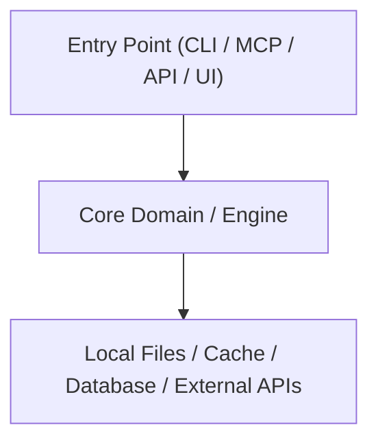
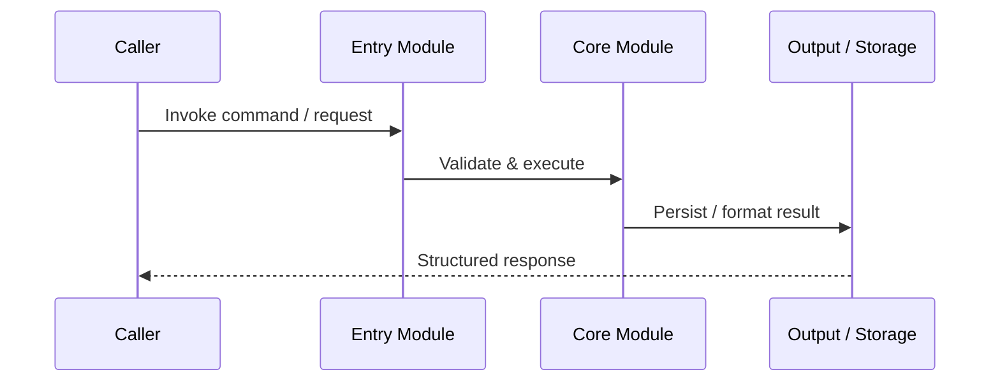

# <Project Name> — Architecture Guide

> **Purpose:** Documents the verified technical architecture of the repository — runtime environment, module boundaries, directory layout, key data flows, external interfaces, and architectural invariants. Grounded strictly in codebase reality.

---

## 1. System Overview & Runtime Topology

Brief description of how the system runs (single CLI/library, local stdio MCP server, client-server web app, multi-tier monorepo, etc.), its primary language/runtime, and external dependencies.



---

## 2. Repository Structure & Module Boundaries

```text
<repo-root>/
├── src/                # Primary source modules
├── test/               # Automated tests & fixtures
├── docs/               # Master PRD, architecture, and feature specs
└── ...
```

| Module / Directory | Responsibility | Allowed Dependencies | Notes |
| :--- | :--- | :--- | :--- |
| `<path>` | [Single clear responsibility] | [Internal/external modules] | [Constraints or entry points] |

---

## 3. Core Data & Execution Flows

Trace the 1–3 most important end-to-end execution paths through the codebase (using exact module/file names verified from source).

### Flow 1: <Primary Pipeline / Request Flow>


---

## 4. Public Interfaces & Contracts

Document the external surfaces that users or other tools rely on (keep only the subsections that apply):

- **CLI Commands & Flags:** [Command names, key options, exit codes]
- **MCP Tools / Resources / Prompts:** [Tool names, inputs, outputs]
- **Programmatic API / Exports:** [Main exported functions/types]
- **HTTP / Event Contracts / Schemas:** [Endpoints, JSON schemas, versioned formats]
- **Storage / Artifact Formats:** [On-disk cache, config files, database schema]

---

## 5. Cross-Cutting Concerns

| Concern | Status | Implementation / Approach | Location |
| :--- | :--- | :--- | :--- |
| **Error Handling** | `[Implemented / Partial / None / N/A]` | [Strategy] | `<path>` |
| **Configuration & Defaults** | `[Implemented / Partial / None / N/A]` | [Strategy] | `<path>` |
| **Caching & Incrementality** | `[Implemented / Partial / None / N/A]` | [Strategy] | `<path>` |
| **Security & Privacy** | `[Implemented / Partial / None / N/A]` | [Strategy] | `<path>` |
| **Logging & Diagnostics** | `[Implemented / Partial / None / N/A]` | [Strategy] | `<path>` |
| **Testing & Quality Gates** | `[Implemented / Partial / None / N/A]` | [Test runner, golden tests, CI] | `<path>` |

---

## 6. Architectural Invariants & Anti-Patterns

### Invariants (Must Hold)
- [e.g., Zero network calls during local scan; strict TypeScript compilation; schema compatibility.]

### Prohibited Practices
- ❌ **[Anti-pattern 1]:** [What to avoid and why]
- ❌ **[Anti-pattern 2]:** [What to avoid and why]

---

## 7. Technical Debt & Open Architectural Questions

- **GAP-01:** [Known architectural debt, missing coverage, or unresolved scaling question]
