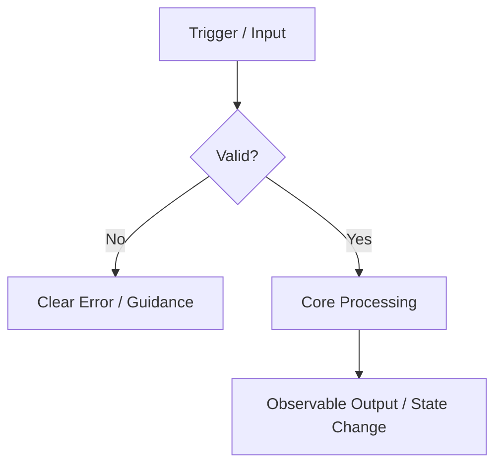

# <Feature Name> — Product Requirements Document (PRD)

> **Purpose:** Defines the intended behavior, user goals, functional requirements (`FR-XX`), boundaries, and edge cases for this feature (**WHAT** and **WHY**). Verification scenarios live in `acceptance_criteria.md`.

---

## 1. Capability Scope Matrix

| Capability | Target Release | Priority | Primary User / Caller | Status |
| :--- | :--- | :--- | :--- | :--- |
| **<Core Capability>** | `v0.1` | `P0 (Must Have)` | [Persona / Caller] | `[Implemented / In Progress / Planned]` |
| **<Secondary Capability>** | `v0.1` | `P1 (Should Have)` | [Persona / Caller] | `[Implemented / In Progress / Planned]` |

---

## 2. Problem Statement & Value

### 2.1 Problem
Explain the specific user or developer friction this feature addresses.

### 2.2 Expected Outcome
State the concrete improvement once this feature is in place.

---

## 3. Explicit Non-Goals

- **NG-01:** [What this feature deliberately does NOT include]
- **NG-02:** [Deferred capability or out-of-scope edge case]

---

## 4. Functional Requirements

Write clear, testable requirements in plain product language (avoid internal code identifiers).

### FR-01: <Requirement Title>
- [Observable system behavior and rules]
- [Input/output expectations or constraints]

### FR-02: <Requirement Title>
- [Observable system behavior and rules]

---

## 5. Primary User / Execution Flow

---

## 6. Edge Cases & Failure Modes

| Condition | Expected System Response |
| :--- | :--- |
| **Empty / Missing Input** | [Graceful output or explicit error message] |
| **Invalid Configuration / Arguments** | [Validation failure without corrupting state] |
| **Partial Failure / Interrupted Run** | [Safe fallback or clear diagnostic] |

---

## 7. Open Questions & Dependencies

| ID | Question / Dependency | Impact | Status |
| :--- | :--- | :--- | :--- |
| **OQ-01** | [Unresolved product or technical question] | [Scope / UX / Compatibility] | `Open` |
