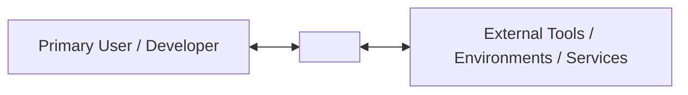

# <Project Name> — Master Product Requirements Document (PRD)

> **Purpose:** Defines the overarching vision, target users, core capabilities, end-to-end workflows, scope boundaries, and success criteria for the product. This document explains **WHAT** the product does and **WHY** — low-level implementation details belong in `docs/architecture.md`.

---

## 1. Executive Summary & Vision

### 1.1 What is <Project Name>?
Concise definition of the product, its archetype (e.g., CLI tool, library, MCP server, API service, web app, mobile app, agent plugin), target runtime/platforms, and the primary problem it solves.

### 1.2 Core Value Proposition
- **For Primary Users (<Persona A>):** [Concrete outcome or workflow improvement]
- **For Secondary Users / Maintainers (<Persona B>):** [Operational, ecosystem, or team benefit]
- **Key Differentiator:** [What makes this approach materially better than common alternatives]

---

## 2. Problem Statement & Value Pillars

### 2.1 The Core Problem
Describe the concrete friction, reliability gap, or operational bottleneck this product solves.

### 2.2 Core Value Pillars
- **Pillar 1 (<Theme>):** [Foundational capability and why it matters]
- **Pillar 2 (<Theme>):** [Foundational capability and why it matters]
- **Pillar 3 (<Theme>):** [Foundational capability and why it matters]

---

## 3. Target Audience & Ecosystem

| Persona / Role | Context / Environment | Primary Goal | Key Touchpoints |
| :--- | :--- | :--- | :--- |
| **<Primary Persona>** | [e.g., Developer using Claude Code / Antigravity] | [Desired outcome] | [CLI commands, MCP tools, UI screens, APIs] |
| **<Secondary Persona>** | [e.g., Maintainer / Contributor / Admin] | [Desired outcome] | [Config, schemas, docs, CI] |

---

## 4. Core User Journeys

### Journey 1: Setup & First Value (Onboarding)
1. **Install / Access:** How the user acquires or enables the product.
2. **Initialize / Configure:** Minimal configuration required (or zero-config default).
3. **First Value:** The first concrete, verifiable result the user gets.

### Journey 2: Primary Daily Workflow (Core Loop)
1. **Trigger:** What initiates the core action.
2. **Execution & Feedback:** How the product processes input and communicates results.
3. **Outcome:** What artifact, state change, or answer is produced.

### Journey 3: Edge Cases, Failure Modes & Recovery
1. **Invalid Input / Degraded Environment:** Missing config, unsupported input, offline state, or partial failure.
2. **Safe Behavior:** Clear diagnostics, non-destructive handling, or graceful fallback.
3. **Recovery:** How the user or system resumes cleanly.

*(Add Journey 4 for multi-role, monetization, or lifecycle flows only if applicable to this project.)*

---

## 5. Capability Overview

High-level map of the product's major capabilities. Detailed requirements live in `docs/features/<slug>/prd.md`.

| Capability | Status | Feature Spec | Summary |
| :--- | :--- | :--- | :--- |
| **<Capability 1>** | `[Implemented / In Progress / Planned]` | `docs/features/01-.../prd.md` | [One-line summary] |
| **<Capability 2>** | `[Implemented / In Progress / Planned]` | `docs/features/02-.../prd.md` | [One-line summary] |

---

## 6. Constraints & Operating Boundaries

- **Runtime / Platform Constraints:** [Supported OS, Node/Python/SDK versions, hardware or offline guarantees]
- **Privacy & Security Guarantees:** [Zero telemetry, local-only execution, permission boundaries, or auth model]
- **Packaging / Distribution:** [npm, PyPI, GitHub release, plugin format, Docker, app store]

---

## 7. Explicit Non-Goals (Scope Containment)

- **NG-01 (<Boundary>):** [What this product explicitly will NOT build or own]
- **NG-02 (<Boundary>):** [Responsibilities delegated to other tools or ecosystems]
- **NG-03 (<Boundary>):** [Deferred or intentionally excluded complexity]

---

## 8. Success Metrics & Quality Signals

| Metric ID | Objective | Target / Signal | Measurement Method |
| :--- | :--- | :--- | :--- |
| **KPI-01** | [Core effectiveness metric] | [Concrete benchmark] | [Benchmark suite / tests / telemetry] |
| **KPI-02** | [Reliability / quality metric] | [Concrete benchmark] | [CI gates / crash rate / schema checks] |
| **KPI-03** | [Performance / efficiency metric] | [Concrete benchmark] | [Latency / token savings / build time] |

---

## 9. Context Gaps, Assumptions & Open Questions

- **GAP-01:** [Unresolved requirement, missing verification, or deferred decision]
- **GAP-02:** [Assumption grounded in current state that may change]
